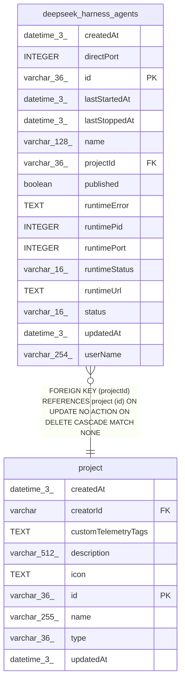

# deepseek_harness_agents

## Description

<details>
<summary><strong>Table Definition</strong></summary>

```sql
CREATE TABLE "deepseek_harness_agents" ("id" varchar(36) PRIMARY KEY NOT NULL, "projectId" varchar(36) NOT NULL, "name" varchar(128) NOT NULL, "status" varchar(16) NOT NULL DEFAULT ('created'), "createdAt" datetime(3) NOT NULL DEFAULT (STRFTIME('%Y-%m-%d %H:%M:%f', 'NOW')), "updatedAt" datetime(3) NOT NULL DEFAULT (STRFTIME('%Y-%m-%d %H:%M:%f', 'NOW')), "userName" varchar(254), "runtimeStatus" varchar(16) NOT NULL DEFAULT ('stopped'), "runtimePid" integer, "runtimePort" integer, "runtimeUrl" text, "runtimeError" text, "lastStartedAt" datetime(3), "lastStoppedAt" datetime(3), "published" boolean NOT NULL DEFAULT (false), "directPort" integer, CONSTRAINT "CHK_deepseek_harness_agents_status" CHECK (("status" IN ('created'))), CONSTRAINT "CHK_deepseek_harness_agents_runtimeStatus" CHECK ("runtimeStatus" IN ('stopped', 'starting', 'running', 'error')), CONSTRAINT "FK_062a16215e05a93c7f6a2f0abc8" FOREIGN KEY ("projectId") REFERENCES "project" ("id") ON DELETE CASCADE ON UPDATE NO ACTION)
```

</details>

## Columns

| Name | Type | Default | Nullable | Children | Parents | Comment |
| ---- | ---- | ------- | -------- | -------- | ------- | ------- |
| createdAt | datetime(3) | STRFTIME('%Y-%m-%d %H:%M:%f', 'NOW') | false |  |  |  |
| directPort | INTEGER |  | true |  |  |  |
| id | varchar(36) |  | false |  |  |  |
| lastStartedAt | datetime(3) |  | true |  |  |  |
| lastStoppedAt | datetime(3) |  | true |  |  |  |
| name | varchar(128) |  | false |  |  |  |
| projectId | varchar(36) |  | false |  | [project](project.md) |  |
| published | boolean | false | false |  |  |  |
| runtimeError | TEXT |  | true |  |  |  |
| runtimePid | INTEGER |  | true |  |  |  |
| runtimePort | INTEGER |  | true |  |  |  |
| runtimeStatus | varchar(16) | 'stopped' | false |  |  |  |
| runtimeUrl | TEXT |  | true |  |  |  |
| status | varchar(16) | 'created' | false |  |  |  |
| updatedAt | datetime(3) | STRFTIME('%Y-%m-%d %H:%M:%f', 'NOW') | false |  |  |  |
| userName | varchar(254) |  | true |  |  |  |

## Constraints

| Name | Type | Definition |
| ---- | ---- | ---------- |
| - | CHECK | CHECK (("status" IN ('created'))) |
| - | CHECK | CHECK ("runtimeStatus" IN ('stopped', 'starting', 'running', 'error')) |
| - (Foreign key ID: 0) | FOREIGN KEY | FOREIGN KEY (projectId) REFERENCES project (id) ON UPDATE NO ACTION ON DELETE CASCADE MATCH NONE |
| id | PRIMARY KEY | PRIMARY KEY (id) |
| sqlite_autoindex_deepseek_harness_agents_1 | PRIMARY KEY | PRIMARY KEY (id) |

## Indexes

| Name | Definition |
| ---- | ---------- |
| IDX_062a16215e05a93c7f6a2f0abc | CREATE INDEX "IDX_062a16215e05a93c7f6a2f0abc" ON "deepseek_harness_agents" ("projectId")  |
| IDX_deepseek_harness_agents_directPort | CREATE UNIQUE INDEX "IDX_deepseek_harness_agents_directPort" ON "deepseek_harness_agents" ("directPort") WHERE "directPort" IS NOT NULL |
| IDX_deepseek_harness_agents_projectId_name | CREATE UNIQUE INDEX "IDX_deepseek_harness_agents_projectId_name" ON "deepseek_harness_agents" ("projectId", "name")  |
| sqlite_autoindex_deepseek_harness_agents_1 | PRIMARY KEY (id) |

## Relations



---

> Generated by [tbls](https://github.com/k1LoW/tbls)
