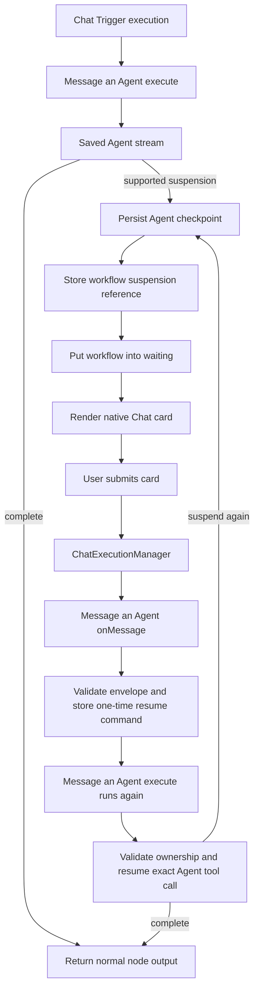

# Message an Agent Workflow Suspension Design

Date: 2026-10-13

Status: Approved in design review

## Summary

Add Agent suspend and resume support to the `Message an Agent` node when a saved Agent runs inside a resumable Chat Trigger execution.

The workflow must wait when the Agent emits a supported suspension. The editor Chat and the public Chat Trigger page must render the existing Agent approval and rich-card interactions. A card response must resume the same Agent run and tool call. The workflow must continue only after the Agent completes.

This change bridges existing Agent runtime behavior into workflow waiting. It does not add new Agent runtime behavior.

## Goals

- Support saved Agents that suspend while `Message an Agent` runs in a Chat Trigger workflow.
- Support the workflow editor Chat surface.
- Support the public Chat Trigger URL surface.
- Render the existing Agent `approval` interaction.
- Render the existing Agent `chat_action` rich-card interaction.
- Preserve the Agent runtime checkpoint, concurrency, and resume behavior.
- Resume the exact `runId` and `toolCallId` with the submitted `resumeData`.
- Let an Agent suspend again after a resume.
- Keep normal `Message an Agent` output compatible.

## Non-goals

- Do not support inline Agents.
- Do not support suspension in non-Chat workflows.
- Do not add an API or webhook resume path.
- Do not add a timeout or timeout-shaped `resumeData`.
- Do not change Agent tool-call concurrency.
- Do not generate forms from `suspendSchema` or `resumeSchema`.
- Do not support unknown suspension payloads in Chat.
- Do not use `json-render-interaction`.
- Do not move Agent Builder `ask_questions` into saved Agents.
- Do not interpret ordinary Chat text as `resumeData`.
- Do not add steering or automatic suspension cancellation.

## Existing Behavior

The Agent runtime already supports checkpoints, `ctx.suspend(payload)`, and `agent.resume(resumeData, { runId, toolCallId })`.

The workflow Agent adapter currently disables this behavior with `supportsHitl: false`. It throws if a suspension still occurs. The workflow stream adapter also ignores `tool-call-suspended` chunks.

The editor Agent Chat already renders these native interactions:

- `approval`
- `chat_action`
- workflow `wait` status cards

This feature only accepts `approval` and `chat_action` as user-resumable workflow Chat interactions. A workflow `wait` card remains under the existing workflow-tool lifecycle.

The public Chat package does not currently render the full Agent rich-card contract. It needs a renderer for the same shared contract. This is a surface adapter. It does not define a new form schema.

## Capability Gate

The system must enable Agent HITL only when all conditions are true:

1. `Message an Agent` calls a saved Agent.
2. The workflow execution came from one of the two supported Chat Trigger entry points.
3. The execution has an active Chat resume channel.
4. The execution has a Chat session identifier.

The two supported entry points are:

- The workflow editor Chat.
- The public Chat Trigger URL.

Use the existing persisted execution context as the capability marker. Require `executionContext.triggerNode.type` to be the Chat Trigger node type, require a Chat session identifier, and require the existing Chat resume channel used by the editor Chat or public Chat Trigger URL. `Message an Agent` must consume these values through its execution context.

The node must not infer the capability from a session ID alone. A normal workflow can configure a custom session ID without a Chat resume channel. The node must not infer the capability from `manual` or `webhook` mode alone. Those modes also run non-Chat workflows.

The workflow Agent adapter passes `supportsHitl: true` only when these persisted context values and the other conditions are valid. It passes `supportsHitl: false` in all other cases. Do not add a second persisted boolean that can drift from the execution context.

If a suspension occurs while the capability is disabled, the node must fail immediately. The workflow must not enter a waiting state.

## Architecture

`Message an Agent` implements the existing node `onMessage` hook. This keeps Chat resume routing in the node that owns the Agent call.

The generic `ChatExecutionManager` continues to enforce its existing rule. It only resumes nodes that implement `onMessage`. It must not gain Agent-specific resume logic.

The system must not add a new public resume endpoint.



## Agent Execution Result

Keep the current `ExecuteAgentData` fields compatible. Add an optional internal suspension result instead of replacing the interface with a breaking discriminated union.

```ts
interface AgentWorkflowSuspensionRef {
	agentId: string;
	threadId: string;
	suspensions: Array<{
		runId: string;
		toolCallId: string;
		interactionType: 'approval' | 'chat_action';
	}>;
}

interface ExecuteAgentData {
	// Existing fields stay unchanged.
	response: string;
	structuredOutput: unknown | null;
	// Other existing fields are omitted here.
	suspension?: AgentWorkflowSuspensionRef;
}
```

The node must not return a suspension result as its final business output. It must use the result to park the workflow.

## State Ownership

The Agent checkpoint is the source of truth for Agent state. It stores:

- Conversation and model state.
- Pending tool calls.
- Suspension payloads.
- Resume schemas.
- Tool continuations.
- Other runtime state needed by Agent resume.

The waiting workflow stores only a lightweight suspension reference. Store this reference in internal execution metadata. Do not add it to the final node JSON output.

The reference contains the saved Agent ID, thread ID, current item index, completed outputs for earlier items, and the current set of `runId` and `toolCallId` pairs. The system replaces this set after each successful resume. It does not merge pending calls independently from the Agent runtime. The completed outputs are node-loop progress only. They are not Agent state.

Do not add a suspension database table.

## Initial Suspension Flow

1. `Message an Agent.execute()` calls the saved Agent.
2. The workflow Agent adapter collects `tool-call-suspended` events.
3. The Agent runtime persists its checkpoint.
4. The adapter classifies every suspension.
5. The adapter rejects unsupported suspension types before workflow waiting begins.
6. The node stores the lightweight suspension reference in execution metadata.
7. The node emits the native Chat card data.
8. The node calls `putExecutionToWait()` with an indefinite workflow wait.

The indefinite workflow wait does not change the Agent checkpoint TTL. The existing Agent checkpoint expiry behavior remains active.

## Resume Flow

The Chat client submits a transport envelope:

```ts
interface AgentWorkflowResumeMessage {
	type: 'agent-suspension-response';
	runId: string;
	toolCallId: string;
	resumeData: unknown;
}
```

This envelope is not a form schema. It transports the existing Agent resume arguments. Reuse the existing Agent Chat resume DTO rules where possible.

`Message an Agent.onMessage()` performs these steps:

1. Read the current waiting execution metadata.
2. Confirm that the target node is the waiting `Message an Agent` node.
3. Confirm that the requested run and tool call exist in the current suspension reference.
4. Preserve the original node input.
5. Store a one-time resume command in internal execution metadata.

The workflow engine then executes the waiting node again. `Message an Agent.execute()` consumes and clears the one-time command before it does other work. It then:

1. Loads the Agent checkpoint.
2. Validates Agent, project, thread, session, and workflow execution ownership.
3. Resumes the exact tool call with the submitted `resumeData`.
4. Lets the Agent runtime validate `resumeData` with its existing resume schema.
5. Continues the current item and then any remaining items for `eachItem` mode.

If the Agent completes, the node clears its suspension metadata and returns the normal `Message an Agent` output. The workflow then continues.

If the Agent suspends again, the node replaces the suspension reference, emits the new cards, and keeps the workflow waiting.

The system must not replay the original user message. The resumed node execution must consume the resume command instead of starting a new Agent run for the suspended item.

For `eachItem` mode, persist the current item index and completed outputs when the node waits. After resume, continue from that item. Do not rerun completed items. If a later item suspends, replace the waiting metadata with that item's state.

## Native Interaction Contract

Support only these user-resumable interaction types in the first version.

### Approval

Render the existing Agent approval card. Submit the existing shape:

```ts
{ approved: boolean }
```

### Chat Action Rich Card

Use the existing shared rich-card schema. Support its current component types:

- `section`
- `fields`
- `image`
- `divider`
- `button`
- `select`
- `radio_select`

Submit the existing Agent shapes:

```ts
{ type: 'button', value: string }

{ type: 'select', id?: string, value: string }
```

Do not create a new interaction schema.

## Frontend Rendering

The editor Chat must reuse the existing `ApprovalCard` and `N8nChatActionCard` components.

The public Chat package must add approval and rich-card renderers that consume the same shared API contract. It can use a separate Vue implementation because the public Chat package has a separate component and theme system.

The public renderer must support the full approved rich-card component list. It must submit the same `resumeData` shapes as the editor renderer.

Both surfaces must:

- Disable a card after a successful submission.
- Prevent duplicate submission.
- Allow retry after a transport failure.
- Block ordinary text input while a blocking card is open.
- Restore an open card after reconnect.
- Show a resolved card as read-only.
- Use i18n for user-facing text.
- Use the package design tokens and existing components.
- Provide keyboard access and accessible labels.

## Streaming and Non-streaming Runs

Both run modes must produce the same suspension result.

For streaming runs, the workflow Agent stream adapter must collect `tool-call-suspended` chunks. It must emit the corresponding Chat card events.

For non-streaming runs, the adapter must read pending suspensions from the final Agent run outcome.

The reconnect path must rebuild cards from persisted workflow metadata and Agent checkpoint state. It must not depend on an active browser stream.

## Multiple Suspensions

Do not define a new concurrency policy.

The Agent runtime remains responsible for tool-call concurrency and pending tool calls. The workflow stores every supported current suspension reference. A card submission resumes only the selected `runId` and `toolCallId`.

After resume, the Agent runtime returns the new pending set. The workflow replaces its stored reference with that set.

## Error Handling

### Retryable Errors

Keep the workflow waiting for these errors:

- `resumeData` fails the existing resume schema.
- The user submits an old card while a newer suspension remains open.
- The user submits the same card more than once.
- Another client already resumed the same tool call.
- The requested run or tool call is not in the current waiting reference.

Reject the request. Show a safe Chat error. Keep the valid open cards active.

### Terminal Errors

End the workflow with an error for these conditions:

- The Agent checkpoint expired.
- The Agent checkpoint is missing or corrupt.
- The saved Agent no longer exists.
- The saved Agent configuration cannot be reconstructed.
- Checkpoint ownership does not match the current project, thread, session, or workflow execution.
- Agent resume produces an unsupported suspension type.

Do not create synthetic timeout data. Do not leave an execution waiting when no valid checkpoint remains.

### Unsupported Context

When a non-Chat workflow suspends, fail with an error that explains that Agent suspension requires a Chat Trigger execution.

When a Chat workflow produces an unsupported interaction, fail with an error that lists `approval` and `chat_action` as the supported interaction types.

## Concurrency and Idempotency

Use the existing Agent orchestrator active-run and checkpoint protections.

The first valid request for a run and tool call can resume it. Later requests for the same resolved call must not run the tool handler again.

Do not add a separate business lock model.

## Disconnect and Reconnect

A browser disconnect must not cancel the waiting workflow.

The workflow and checkpoint stay persisted. A client that reconnects to the same authorized Chat session must receive the current open cards. Resolved cards must remain read-only.

## Security

Treat client-provided `runId` and `toolCallId` values as selectors, not authorization.

Before resume, validate all of these bindings:

- Workflow execution.
- Waiting node.
- Saved Agent.
- Project.
- Thread.
- Chat session.
- Current suspension reference.
- Agent checkpoint ownership.

The client must not select a suspension from another execution, session, project, or Agent.

Do not expose checkpoint contents in an error or node output.

## Compatibility

- Keep the current final node output shape.
- Do not add a user-visible node parameter.
- Do not add a new node version only for this behavior.
- Keep non-Chat behavior unchanged.
- Keep inline Agent behavior unchanged.
- Keep Agent checkpoint TTL unchanged.
- Keep Agent tool-call concurrency unchanged.

## Test Plan

### Backend Unit and Integration Tests

Cover these cases:

1. Enable HITL for editor Chat Trigger execution.
2. Enable HITL for public Chat Trigger execution.
3. Keep HITL disabled for other manual, webhook, and trigger executions.
4. Do not treat a custom session ID as Chat capability.
5. Keep HITL disabled for inline Agents.
6. Preserve normal completed output.
7. Park the workflow for an approval suspension.
8. Park the workflow for a chat-action suspension.
9. Reject an unknown suspension before waiting.
10. Reject a suspension in a non-Chat workflow.
11. Resume the correct run and tool call.
12. Keep waiting after invalid resume data.
13. Reject duplicate and stale responses without repeating the tool action.
14. End the workflow when the checkpoint expired.
15. Replace waiting metadata when the Agent suspends again.
16. Continue the workflow when the Agent completes.
17. Resume only the selected call when several suspensions exist.
18. Reject project, thread, session, Agent, and execution ownership mismatches.
19. Preserve the behavior in streaming and non-streaming modes.
20. Restore open cards after reconnect.

### Frontend Component Tests

For the editor Chat, verify the existing approval and rich-card components submit the workflow resume envelope and become read-only after success.

For the public Chat, verify:

- Approval rendering and submission.
- Button rendering and submission.
- Select rendering and submission.
- Radio-select rendering and submission.
- Section, fields, image, and divider rendering.
- Duplicate-submission prevention.
- Retry after transport failure.
- Input blocking while a card is open.
- Open-card restoration after reconnect.
- Keyboard access and accessible labels.

### End-to-end Tests

Add these primary flows:

1. Editor Chat Trigger to `Message an Agent`, approval, Agent completion, and downstream node execution.
2. Public Chat Trigger URL to `Message an Agent`, select or radio response, Agent completion, and final public Chat response.
3. A non-Chat workflow that receives a suspension and fails without entering waiting.

## Acceptance Criteria

- Both supported Chat surfaces can resume a saved Agent through `Message an Agent`.
- Both surfaces render approval, button, select, and radio-select interactions.
- A valid card response resumes the exact suspended tool call.
- A second suspension keeps the same workflow waiting.
- Agent completion continues the workflow exactly once.
- Unsupported contexts and interaction types fail before an unrecoverable wait.
- Checkpoint expiry ends the waiting workflow with an error.
- Normal `Message an Agent` executions remain compatible.
- The implementation does not depend on JSON Render.
