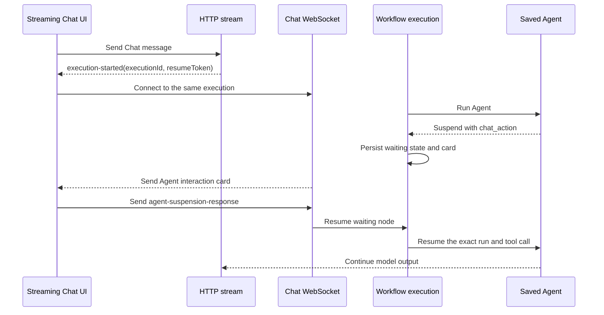

# Streaming Chat Agent Interaction Resume Design

Date: 2026-10-14

Status: Approved in design review.

## Summary

Connect the public streaming Chat client to the existing Chat WebSocket before a workflow enters the waiting state.

The HTTP stream remains the source for model output while the workflow runs. The WebSocket becomes the source for blocking Agent interactions and their responses. This split lets a card response resume the same workflow execution.

This design fixes the current failure where a radio option changes visually but sends no response. The failure occurs because the streaming Chat path never creates a WebSocket. The interaction component only submits through an open WebSocket.

## Goals

- Make Agent interaction controls work in a streaming Chat Trigger session.
- Resume the same workflow execution after a card response.
- Keep every intermediate model turn visible.
- Keep model turn numbers continuous within one user message execution.
- Show the same interaction lifecycle as the standalone Agent view.
- Remove a resolved card from the active Chat view.
- Record one response event for the resolved Chat action.
- Prevent raw suspension envelopes from appearing as user messages.
- Keep one transport source for each interaction card.

## Non-goals

- Do not replace HTTP model streaming with WebSocket streaming.
- Do not add a public resume endpoint.
- Do not interpret normal Chat text as Agent resume data.
- Do not change the Agent interaction schema.
- Do not change the standalone Agent transport.
- Do not add support for non-Chat workflow suspension.
- Do not change non-streaming hosted Chat behavior.

## Current Behavior

The streaming Chat client sends the user message with an HTTP request. It reads newline-delimited `StructuredChunk` values from the response.

The non-streaming hosted Chat response contains `executionId` and `resumeToken`. The Chat input uses these values to open a WebSocket.

The streaming response does not return these values. It only returns node stream chunks. The Chat input therefore does not open a WebSocket.

The workflow can still enter the waiting state. The HTTP stream can also render the Agent interaction card. However, the card has no valid response transport. The current interaction component checks for an open WebSocket and returns without an error when none exists. The selected radio remains visible, but the workflow does not resume.

Sending the suspension response as a new HTTP Chat message is not correct. That path starts a new Chat request. It can store the transport envelope as visible user text. It can also restart model-turn numbering and call input-fetch logic for the new request.

## Transport Ownership

Use one transport for each responsibility.

| Responsibility | Transport |
| --- | --- |
| Start the workflow | HTTP request |
| Stream model and node text | HTTP newline-delimited stream |
| Announce the execution resume channel | HTTP control frame |
| Deliver a blocking Agent interaction | Chat WebSocket |
| Submit the interaction response | Chat WebSocket |
| Continue model output after resume | Existing workflow and Agent stream path |

The HTTP stream must not render the same blocking Agent interaction that the WebSocket sends. The WebSocket is the only card source for a resumable streaming Chat execution.

## Execution-Started Control Frame

Add a control frame to the shared streaming protocol.

```ts
interface ExecutionStartedChunk {
	type: 'execution-started';
	executionId: string;
	resumeToken: string;
}
```

Model and node chunks keep their current shape.

```ts
type StreamingChunk = StructuredNodeChunk | ExecutionStartedChunk | KeepaliveChunk;
```

The control frame has no node metadata. It describes the execution transport. It is not a node output.

The backend sends this frame immediately after it registers the active execution. It sends the frame before it starts or enqueues workflow work. This order gives the client time to connect while the workflow runs.

The backend sends the frame only when all of these conditions are true:

1. Streaming is enabled.
2. The HTTP response is available.
3. The persisted execution context identifies a Chat Trigger.
4. The execution data contains a resume token.

The backend must not send this frame for a generic streaming Webhook. This rule limits the resume capability to Chat executions.

The frame must use the same newline-delimited JSON framing as current stream chunks. It must flush immediately.

## Client Stream Handling

The stream parser accepts the control frame as a typed protocol value. It must not convert the frame into an `item` chunk.

The Chat plugin handles the frame with a new callback:

```ts
onExecutionStarted(executionId: string, resumeToken: string): void;
```

The callback emits the existing `setupWebsocket` event. The Chat input opens the WebSocket with the execution ID, current session ID, public-chat flag, and resume token.

The control frame does not create a Chat message. It does not count as received model content. It does not create an empty bot response.

The client must treat a second identical frame as idempotent. It must not open two WebSockets for the same execution. If a different execution replaces an active connection, the client closes the old connection before it opens the new one.

## WebSocket Handoff

The existing Chat service accepts a WebSocket while the workflow is still running. It validates the execution ID and resume token. It then polls the execution state.

When the workflow becomes waiting, the Chat service reads the waiting node message and sends the Agent interaction card over the WebSocket.

The sequence is:



The Chat service must continue to poll a running execution. An early WebSocket connection must not fail because the execution is not waiting yet.

## Single Card Source

The workflow Agent stream adapter can observe the Agent suspension before the workflow reaches the waiting state. It must collect and persist the suspension, but it must not emit the blocking card as an HTTP node chunk for a resumable Chat execution.

The waiting node result remains the durable card source. The Chat service sends that result through the WebSocket after it observes the waiting state.

This rule prevents two cards:

- One transient card from the HTTP stream.
- One durable card from the WebSocket waiting path.

Non-resumable contexts keep their existing error behavior. They must not silently suppress an unsupported suspension.

## Interaction Submission

The interaction component sends the existing envelope through the open Chat WebSocket.

```ts
interface AgentWorkflowResumeMessage {
	type: 'agent-suspension-response';
	runId: string;
	toolCallId: string;
	resumeData: unknown;
}
```

The component must not use the normal `sendMessage` HTTP path.

The interaction control stays disabled until the WebSocket is open. A click must never update the selected state without either sending the response or showing a transport error.

After `WebSocket.send()` succeeds, the client removes the active card. It keeps duplicate submission blocked. If the send call throws, the client keeps the card visible and enables retry.

The server validates the execution, session, waiting node, run ID, tool call ID, and resume token before it resumes the workflow.

## Conversation and Timeline Semantics

One user message can contain several Agent model turns and several interactions. A resumed Agent call is part of that same message execution.

The model-turn counter belongs to the Agent run inside the current user message. It starts at one for a new user message. It increments after tool calls and resumed interactions. A card response must not create another user message or reset the counter.

Each Chat action has these timeline phases:

1. Tool call starts.
2. Tool call waits for input.
3. The response is received.

The third phase appears only after the resume message is accepted. The UI can show the same three Chat action entries as the standalone Agent view.

The server must not store the resume envelope as `chatInput`. It must record the response as an Agent HITL event.

## Ordering and Race Handling

The backend sends `execution-started` before any workflow work begins. This minimizes the chance that a fast suspension occurs before the WebSocket connects.

The durable waiting state handles the remaining race. If the workflow reaches waiting first, the Chat service sends the card when the WebSocket connects and polls the execution.

The client must not render an active interaction from the HTTP stream. Therefore, a user cannot submit before the WebSocket path is ready.

If WebSocket setup fails, the client must clear its indefinite thinking state and show a recoverable connection error. It must not show an interactive card that cannot submit.

If the HTTP stream closes while the workflow waits, the WebSocket remains responsible for the card response. After the workflow resumes, output follows the existing execution stream behavior. This change does not introduce a second HTTP request.

## Compatibility

- Existing `begin`, `item`, `end`, `error`, and `keepalive` chunks keep their meaning.
- Older clients ignore the unknown `execution-started` frame through their existing switch behavior.
- New clients ignore the control frame for Chat rendering.
- Non-streaming hosted Chat keeps its current JSON response and WebSocket setup.
- Generic streaming Webhooks do not receive the Chat resume token.
- Existing WebSocket heartbeat and continue frames stay unchanged.
- Standalone Agent interaction rendering stays unchanged.

## Security

The resume token is a capability credential.

- Send it only on the authenticated or authorized Chat request that created the execution.
- Send it only for a Chat Trigger execution.
- Do not include it in node metadata, Chat messages, execution logs, debug previews, or timeline events.
- Do not store it in browser-visible message history.
- Use it only to create the WebSocket URL.
- Keep the existing timing-safe server validation.
- Validate the execution and session again for each response.

Logs can state that a resume token is present. Logs must not record its value.

## Observability

Add concise debug events for these transitions:

- The execution-started control frame was sent.
- The client requested WebSocket setup for an execution.
- The Chat service attached to a running execution.
- The Chat service sent a waiting interaction.
- The server accepted or rejected an interaction response.

Use execution IDs and session IDs where current logging policy permits them. Do not log resume tokens or full resume data.

## Error Handling

### Stream Control Frame Failure

If the server cannot write the execution-started frame, stop the HTTP response and let normal execution cleanup run. Do not start an execution that the streaming Chat client cannot resume.

### WebSocket Connection Failure

Show a recoverable connection error. Do not enable interaction controls. The waiting workflow remains persisted for reconnect.

### Interaction Send Failure

Keep the card visible. Restore its controls. Let the user retry.

### Rejected Response

Keep the current valid waiting card active. Show a safe error. Do not start another workflow execution.

## Type Ownership

Define the shared streaming control type in `n8n-workflow`. Export a discriminated streaming-frame union.

The public Chat package can mirror or import the transport shape according to its current package dependency boundary. It must use a type guard before it reads execution fields.

Do not make node metadata optional on normal node chunks. Keep the execution control frame as a separate union member.

## Expected Code Areas

- `packages/workflow/src/interfaces.ts`
- `packages/cli/src/workflow-runner.ts`
- `packages/cli/src/active-executions.ts`
- `packages/cli/src/modules/agents/workflow-agent-stream.ts`
- `packages/cli/src/chat/chat-service.ts`
- `packages/frontend/@n8n/chat/src/types/streaming.ts`
- `packages/frontend/@n8n/chat/src/api/message.ts`
- `packages/frontend/@n8n/chat/src/plugins/chat.ts`
- `packages/frontend/@n8n/chat/src/components/Input.vue`
- `packages/frontend/@n8n/chat/src/components/MessageAgentInteraction.vue`

The implementation can touch fewer files if an existing abstraction already owns a step.

## Test Plan

Confirm these test cases before implementation.

### Backend

1. A streaming Chat Trigger execution sends `execution-started` before workflow chunks.
2. The control frame contains the registered execution ID and its resume token.
3. A generic streaming Webhook does not receive the control frame.
4. A Chat execution without a resume token does not receive an incomplete control frame.
5. The HTTP stream does not emit an Agent interaction card for a resumable Chat execution.
6. The waiting execution exposes the card to the Chat WebSocket service.
7. The Chat service accepts an early connection while the execution is running.
8. A valid card response resumes the same execution and tool call.
9. The server rejects a response with the wrong token, execution, session, run, or tool call.
10. The server records the response as an HITL event and not as user `chatInput`.

### Public Chat Frontend

1. The stream parser recognizes `execution-started` across split network chunks.
2. The control frame calls `onExecutionStarted` and does not render a message.
3. The Chat plugin emits one WebSocket setup event for one execution.
4. The input replaces an old WebSocket only when the execution ID changes.
5. The interaction stays disabled until the WebSocket is open.
6. A valid radio, select, or button response sends the correct resume envelope.
7. A successful send removes the active card.
8. A failed send keeps the card and permits retry.
9. The response does not appear as a raw user message.

### Integration

Run one streaming Chat Trigger workflow with `Message an Agent` and several Chat actions.

Verify all of these results:

- The first model turn appears.
- Each intermediate model turn appears.
- Model turn numbers increment inside the same user message execution.
- Each interaction appears once.
- Each accepted interaction produces a response-received timeline event.
- A resolved interaction is not left active in the Chat view.
- No `fetch_input_data` tool call occurs for the resume transport.
- No raw suspension envelope appears in Chat history.
- The same workflow execution continues to completion.

## Acceptance Criteria

- Clicking an enabled Agent interaction control always sends a response or shows an error.
- A response resumes the exact waiting workflow execution.
- Streaming Chat uses WebSocket for interaction delivery and response.
- The HTTP stream does not duplicate an interaction card.
- Resolved cards leave the active Chat view.
- Model turns and Chat action timeline entries match standalone Agent semantics.
- Resume transport data never appears as user-visible Chat content.
- Non-Chat streaming workflows do not receive Chat resume credentials.
