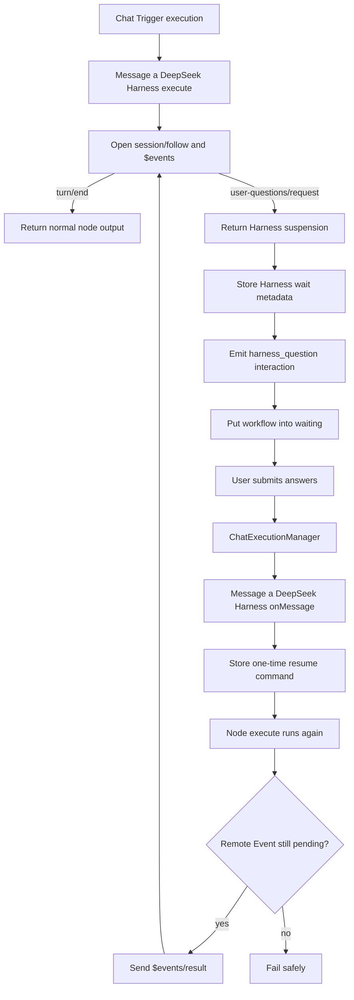

# Message a DeepSeek Harness Workflow Suspension Design

Date: 2026-10-15

Status: Approved in design review

## Summary

Add workflow suspend and resume support to the `Message a DeepSeek Harness` node for the Harness `ask_user_question` tool.

The node waits when Harness requests user input during a resumable Chat Trigger execution. The editor Chat and the public Chat Trigger page render the Harness questions. A submitted answer resumes the same Harness session and question. The workflow continues only after Harness completes or requests more input.

This feature reuses the generic workflow Chat transport. It does not reuse the saved Agent checkpoint or saved Agent resume implementation.

## Goals

- Support `ask_user_question` from `Message a DeepSeek Harness`.
- Support the workflow editor Chat and the public Chat Trigger URL.
- Preserve the Harness session across workflow suspension.
- Render one or more Harness questions.
- Support single-select, multi-select, and custom text answers.
- Resume the exact pending Harness Remote Event.
- Let Harness request more input after a resume.
- Preserve completed output for earlier input items.
- Keep normal Harness streaming and output behavior compatible.

## Non-goals

- Do not support Harness approval requests.
- Do not add support to `Message an Agent`.
- Do not create or use an Agent runtime checkpoint.
- Do not convert Harness events into `tool-call-suspended` stream chunks.
- Do not add a new public resume endpoint.
- Do not resume from ordinary Chat text.
- Do not add a user-visible node option.
- Do not add an n8n response timeout to the Harness follow stream.
- Do not support timed question waits or late answers.
- Do not guarantee recovery after a Harness process restart for a live Remote Event.

## Capability Gate

Enable Harness interaction only when all conditions are true:

1. The source is `Message a DeepSeek Harness`.
2. The workflow execution came from a Chat Trigger.
3. The execution has an active Chat resume channel.
4. The node resolved a non-empty session ID.
5. Harness emitted `user-questions/request`.

A session ID alone must not enable workflow interaction. Manual and webhook execution modes alone must not enable it.

If Harness requests input outside this gate, the node fails. It must not put the workflow into an unrecoverable wait.

## Architecture

`Message a DeepSeek Harness` owns the wait state. It implements `onMessage()` and uses the existing `ChatExecutionManager` routing.

The Harness RPC service opens two logical streams on the same authenticated Remote Mux connection:

- `session/follow` provides assistant text and turn completion.
- `$events` provides `user-questions/request` events.

The node uses the existing `ExecuteAgentData.suspension` result as an internal bridge. It stores separate Harness workflow metadata. It does not write Harness state into `agentWorkflowSuspension`.



## Harness Question Contract

Add `harness_question` to the workflow Agent interaction transport. The name identifies a renderer. It does not identify a saved Agent operation.

The interaction payload preserves the Harness question structure:

```ts
interface HarnessQuestion {
	id: string;
	question: string;
	detail?: string;
	header?: string;
	options?: Array<{ label: string; description?: string }>;
	multiSelect?: boolean;
}

interface HarnessQuestionInteractionPayload {
	type: 'harness-question';
	questions: HarnessQuestion[];
}
```

The client submits the Harness answer structure without translation:

```ts
interface HarnessQuestionAnswer {
	answers: Array<{
		id: string;
		selected: string[];
		custom?: string;
	}>;
}
```

Use the existing `agent-suspension-response` envelope for transport. The envelope carries `runId`, `toolCallId`, and the answer as `resumeData`. The generic Chat transport does not depend on the runtime that produced the interaction.

## State Ownership

Harness remains the source of truth for the conversation and pending question.

The workflow stores `DeepSeekHarnessWorkflowWaitMetadata` in task metadata. It contains:

- Harness profile ID.
- Harness session ID.
- Current input item index.
- Completed node outputs from earlier items.
- Remote Event ID.
- Harness question call ID when present.
- The question payload.
- An optional one-time resume command.

The metadata must not contain authentication cookies or Remote Event client IDs. A Remote Event client ID belongs to one connection and changes after reconnect.

The node clears this metadata after Harness completes. A later question replaces the previous pending reference.

## Initial Suspension Flow

1. The node resolves its Harness profile, workspace, message, and session ID.
2. The node enables interaction only when the capability gate passes.
3. The RPC service authenticates and opens `session/follow` and `$events`.
4. The RPC service starts or reuses the Harness session.
5. The RPC service sends the prompt after both streams are ready.
6. Assistant text continues through the existing response chunk path.
7. A `user-questions/request` event ends the current RPC call with a suspension result.
8. The node stores Harness wait metadata.
9. The node emits one `harness_question` interaction.
10. The node calls `putExecutionToWait()` with the existing indefinite wait value.

The RPC service ignores other Remote Events in this version. It must not classify an approval event as an `ask_user_question` event.

## Resume Flow

`onMessage()` parses the existing workflow resume envelope. It verifies that `runId` and `toolCallId` match the current Harness wait metadata. It stores a one-time resume command and preserves the original node input.

The next `execute()` call resumes the suspended input item. It must not resend the original prompt.

The RPC service authenticates again and opens `session/follow` and `$events` for the stored Harness session. If `$events` reports the same pending Remote Event, send `$events/result` with the new connection client ID and the stored Remote Event ID. If the event is not pending, fail with a terminal error.

This version assumes that Harness disables timed question waits. It does not call `userQuestions/attachWait` or `userQuestions/answer`.

After the answer, keep following the same Harness session. Return normal output on `turn/end`. Return a replacement suspension if Harness asks another question.

## Multiple Input Items

Store the suspended item index and completed outputs in task metadata.

On resume:

- Restore completed outputs.
- Resume only the suspended item.
- Continue later items after that item completes.
- Do not run earlier items again.
- Replace the metadata if a later item suspends.

## Frontend Rendering

Both Chat surfaces render `harness_question` with the same behavior:

- Show every question in the request.
- Show the optional header and detail.
- Use radio controls for single-select options.
- Use checkbox controls for multi-select options.
- Show a text input when the question has no options.
- Allow a custom text answer when the Harness question accepts it.
- Submit all answers together.
- Disable duplicate submission.
- Allow retry after a transport failure.
- Block ordinary Chat input while the question is open.
- Remove the interactive card after a successful submission.
- Restore an open card after reconnect.

Use i18n for new editor text. Use design-system components and CSS variables.

## Streaming

Assistant text keeps the current streaming behavior. A question can arrive after text chunks. The node returns the interaction without duplicating the streamed text.

The resume call follows the same session. It can stream more assistant text, suspend again, or complete.

## Error Handling

Reject the Chat response and keep the workflow waiting when:

- The envelope is malformed.
- The response references an old event or call ID.
- The answer shape is invalid.
- The transport fails before Harness accepts the answer.

End the workflow with an error when:

- The Harness profile no longer exists.
- The Harness session no longer exists.
- The live Remote Event is no longer pending.
- Harness rejects the answer after the pending interaction is no longer recoverable.
- Harness requests user input outside a resumable Chat Trigger execution.

Do not expose cookies, internal Remote Event state, or unrelated session data in errors.

## Concurrency and Idempotency

Only the current stored event and call ID can resume the workflow. Clear the one-time command after Harness accepts it.

The first successful submission wins. A later submission for the same card must not send the answer again.

Do not add a second business lock model. Use the existing Harness execution lock and workflow waiting state.

## Compatibility

- Keep the final node output shape unchanged.
- Keep non-interactive Harness calls unchanged.
- Keep existing streaming behavior unchanged.
- Keep the current session creation and workspace selection behavior.
- Keep the 30-second timeout for discrete RPC requests.
- Let the Harness follow stream run until Harness completes, fails, or closes the connection.
- Do not change saved Agent workflow suspension behavior.

## Acceptance Criteria

- A Harness `ask_user_question` request waits in a Chat Trigger workflow.
- Editor Chat and public Chat render every question and accepted input mode.
- A valid answer resumes the same Harness session without replaying the prompt.
- A second question keeps the same workflow waiting.
- Harness completion continues the workflow exactly once.
- Earlier input items do not rerun after a later item suspends.
- Unsupported contexts fail before the workflow waits.
- Normal Harness calls and saved Agent interactions remain compatible.
